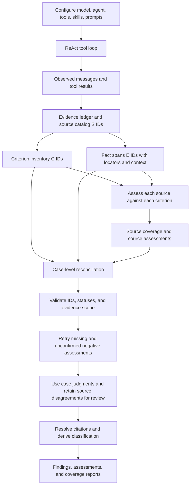

# Underwriting agent: data structures and data flow

## Scope

[`agent_starter.ipynb`](../notebooks/agent_starter.ipynb) is a small LangChain `create_agent` / LangGraph ReAct example with local skills, tagged tools, and a structured assessment stage. [`evidence.py`](../src/tiny_skill_agent/evidence.py) records provenance and validates citations. [`agent.py`](../src/tiny_skill_agent/agent.py) provides a simpler chat CLI without this assessment stage. The notebook uses Ollama by default and can be configured for OpenAI.

The assessment compares each **observed data source** with every **observed labeled criterion**, then reconciles all observed sources for the case. It aims to recover single-source and cross-source strengths and concerns while exposing incomplete assessment coverage.

The reusable `assess(criteria=..., evidence=..., model=..., config=...)` API lives in [`assessment.py`](../src/tiny_skill_agent/assessment.py). [`adapters.py`](../src/tiny_skill_agent/adapters.py) converts LangChain messages and models or exposes a LangGraph node. The notebook is a configuration and display client. The core accepts explicit criteria with arbitrary classifications; bracketed labels are a convention of the message adapter. See [INTEGRATION.md](INTEGRATION.md) for API examples and migration details.

## IDs and source records

| ID | Assigned by code | Contains |
| --- | --- | --- |
| `S1`, `S2`, ... | `build_source_catalog` | One observed system prompt, skill read, directive-tool result, or data-tool result. Full identities include `system_prompt`, `skill:<name>`, and `tool:<name>#<call_id>`. |
| `C1`, `C2`, ... | `build_criterion_inventory` | One exact line beginning `[strength]` or `[concern]` in a permitted directive source, plus its `S` ID. |
| `E1`, `E2`, ... | `build_fact_spans` | One nonempty text line or JSON leaf from a data source, plus its `S` ID, line/JSON-pointer locator, quote, and context. |

These IDs are local to one run. JSON context includes the parent object when available; text context includes neighboring lines. The model selects short `C` and `E` IDs, and code expands them after validation. General instructions without a classification prefix can still guide the agent but do not enter the criterion inventory.

`tag_tool(tool, "directive")` and `tag_tool(tool, "data")` register evidence kinds. `read_skill` has source kind `skill`; the system prompt has source kind `system_prompt`; ordinary tools have source kind `tool`. `EvidenceMetadataMiddleware` attaches `_meta` to successful tool messages. `collect_evidence` verifies the observed call and metadata before routing the result. Failed or unobserved results do not become evidence.

## Flow



The default `AssessmentConfig.batch_size` is one criterion per model call because the sample local model was unreliable when asked for several assessments together. Each source call receives spans from that source; a cited `E` ID from another source is rejected. The case call receives all spans and the source assessments for its requested criteria, so one finding can cite several sources. Bounded retries target missing assessments. The case pass can overturn provisional source matches using contradictions, newer evidence, or exceptions. Disagreements remain visible, and a missing case assessment never promotes a source match automatically.

Only observed data sources and observed labeled criteria are covered. A skill never read or data tool never called is outside this run's coverage.

## Model-facing schema

The Pydantic structured output is a top-level list:

```python
class CriterionAssessment(BaseModel):
    criterion_id: str                 # C-number
    status: Literal[
        "matched", "no_match", "insufficient_evidence", "not_applicable"
    ]
    evidence_ids: list[str]          # E-numbers
    reason: str

class CoverageDraft(RootModel[list[CriterionAssessment]]):
    pass
```

Example:

```json
[{"criterion_id": "C2", "status": "matched", "evidence_ids": ["E1"], "reason": "Eight months of reserves exceeds the six-month threshold."}]
```

| Status | Meaning | Evidence IDs |
| --- | --- | --- |
| `matched` | Observed data supports the criterion. | At least one cited span. |
| `no_match` | Relevant observed data establishes that an applicable condition is not met. | At least one cited span. Missing facts alone do not qualify. |
| `insufficient_evidence` | Available data is missing or too ambiguous to decide. | Optional partial spans. |
| `not_applicable` | Evidence establishes that the criterion's stated scope excludes the case. | At least one cited span. |

`no_match` requires a second case assessment by default. This is a consistency check. The validator verifies ID existence and source scope; it cannot prove the status or reason logically follows from the cited data.

## Final output and coverage

The API returns `AssessmentResult.findings`, a list of `Finding` models. The notebook displays it as `result["structured_response"]`, a `RootModel[list[Finding]]`. Each accepted case match contains the criterion ID and exact text, full source identity, classification supplied by the criterion, a reason, and one or more resolved fact citations:

```json
[{"criterion_id": "C2", "criterion": "[strength] Classify cash reserves of at least six months as a strength.",
  "criterion_source": "skill:underwriting-demo",
  "criterion_source_label": "Skill: underwriting-demo",
  "classification": "strength",
  "facts": [{"evidence_id": "E1", "source": "tool:get_underwriting_facts#<call_id>",
             "source_label": "Tool: get_underwriting_facts (S4)",
             "locator": "json:/0", "quote": "Cash reserves: 8 months",
             "context": "Cash reserves: 8 months"}],
  "reason": "Eight months of reserves exceeds the six-month threshold."}]
```

`facts` supports several spans from one source or across sources. The API emits at most one case finding per criterion, with duplicate evidence IDs removed. Source candidates remain in `source_assessments`. This is criterion assessment coverage, not a guarantee that every distinct event satisfying a criterion becomes a separate finding.

`result["source_assessments"]` holds accepted provisional source/criterion assessments. `result["criterion_assessments"]` holds final case statuses, including non-matches. `result["inputs"]` contains the portable criteria and evidence records with their original source identities; the message adapter's temporary `S` catalog is internal. `result["disagreements"]` identifies source matches overturned in the case pass.

`result["source_coverage"]` reports missing source/criterion pairs. `result["coverage"]` reports `matched`, `no_match`, `insufficient_evidence`, `not_applicable`, missing and unconfirmed criterion IDs, plus errors. `complete` means all expected source and case assessments were returned and negative judgments confirmed. `decision_ready` additionally requires a nonempty criterion set, no `insufficient_evidence` statuses, and no source-match disagreements. Complete coverage does not establish semantic correctness.

## Trust boundaries and extensions

- **Observed provenance:** Metadata and call IDs establish which registered tool produced a result, not that upstream data is true.
- **Citation validity:** IDs, source checks, and locators establish that cited text appeared in an observed source, not that the reason uses it correctly.
- **Atomicity:** One line or JSON leaf per `E` ID makes citations precise; context retains nearby text. Complex documents may require richer spans, table coordinates, or derived values.
- **Scale:** Per-source and per-criterion calls increase latency. Configurable batches and output limits do not provide retrieval, chunk scheduling, or guaranteed recall.
- **Audit:** A production system should persist model version, prompts, tool inputs and outputs, source catalog, evidence spans, accepted and rejected assessments, and reviewer decisions.

Related papers and evaluation guidance are in [RESEARCH.md](RESEARCH.md).
