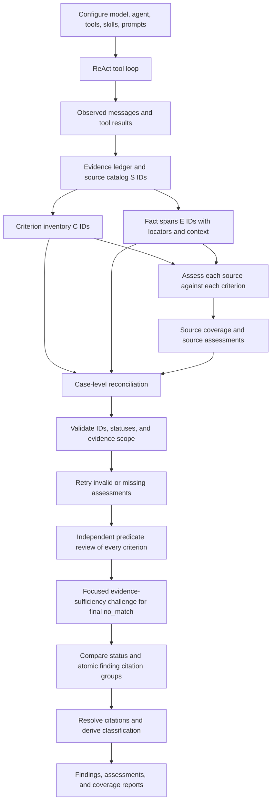

# Underwriting agent: data structures and data flow

## Scope

[`agent_starter.ipynb`](../notebooks/agent_starter.ipynb) is a small LangChain `create_agent` / LangGraph ReAct example with local skills, tagged tools, and a structured assessment stage. [`evidence.py`](../src/tiny_skill_agent/evidence.py) records provenance and validates citations. [`agent.py`](../src/tiny_skill_agent/agent.py) provides a simpler chat CLI without this assessment stage. The notebook uses Ollama by default and can be configured for OpenAI.

The assessment compares each **observed data source** with every **observed labeled criterion**, then reconciles all observed sources for the case. It aims to recover single-source and cross-source strengths and concerns while exposing incomplete assessment coverage.

The reusable `assess(criteria=..., evidence=..., model=..., config=...)` API lives in [`assessment.py`](../src/tiny_skill_agent/assessment.py). [`adapters.py`](../src/tiny_skill_agent/adapters.py) converts LangChain messages and models or exposes a LangGraph node. The notebook is a configuration and display client. The core accepts explicit criteria with arbitrary classifications; bracketed labels are a convention of the message adapter. See [INTEGRATION.md](INTEGRATION.md) for API examples and migration details.

## IDs and source records

| ID | Assigned by code | Contains |
| --- | --- | --- |
| `S1`, `S2`, ... | `build_source_catalog` | One observed system prompt, skill read, directive-tool result, or data-tool result. Full identities include `system_prompt`, `skill:<name>`, and `tool:<name>#<call_id>`. |
| `C1`, `C2`, ... | `build_criterion_inventory` | One exact line beginning `[strength]` or `[concern]` in a permitted directive source, plus its `S` ID. |
| `E1`, `E2`, ... | `build_fact_spans` | One nonempty text line or JSON leaf from a data source, plus its `S` ID, line/JSON-pointer locator, quote, and context. |

These IDs are local to one run. JSON context includes the parent object when available; text context includes neighboring lines. The model selects short `C` and `E` IDs, and code expands them after validation. General instructions without a classification prefix can still guide the agent but do not enter the criterion inventory.

`tag_tool(tool, "directive")` and `tag_tool(tool, "data")` register evidence kinds. `read_skill` has source kind `skill`; the system prompt has source kind `system_prompt`; ordinary tools have source kind `tool`. `EvidenceMetadataMiddleware` attaches `_meta` to successful tool messages. `collect_evidence` verifies the observed call and metadata before routing the result. Failed or unobserved results do not become evidence.

## Flow



The default `AssessmentConfig.batch_size` is one criterion per model call because the sample local model was unreliable when asked for several assessments together. Each source call receives spans from that source; a cited `E` ID from another source is rejected. The case call receives all spans, source assessments, and detected conflict candidates. A criterion can contain multiple independent findings, each citing one or more sources. Bounded retries include validation feedback. The case pass can overturn provisional source judgments using supported corrections or exceptions. Disagreements remain visible, and a missing case assessment never promotes a source match automatically.

Only observed data sources and observed labeled criteria are covered. A skill never read or data tool never called is outside this run's coverage.

## Normalized assessment schema

The normalized API output is a top-level list. The LangChain model-facing schema is `PredicateDraft`, described below; code converts it into these records:

```python
class FindingDraft(BaseModel):
    subject: str
    evidence_ids: list[str]
    reason: str

class CriterionAssessment(BaseModel):
    criterion_id: str                 # C-number
    status: Literal[
        "matched", "no_match", "insufficient_evidence", "not_applicable"
    ]
    basis: Literal[
        "condition_met", "condition_not_met", "exception_applies",
        "scope_excluded", "missing_evidence", "unresolved_conflict"
    ]
    evidence_ids: list[str]          # E-numbers
    reason: str
    findings: list[FindingDraft]
    conflict: Literal["none", "resolved", "unresolved", "different_scope"]

class CoverageDraft(RootModel[list[CriterionAssessment]]):
    pass
```

Example:

```json
[{
  "criterion_id": "C2", "status": "matched", "basis": "condition_met",
  "evidence_ids": ["E1", "E2"], "conflict": "none",
  "reason": "Both applicants independently exceed the six-month reserve threshold.",
  "findings": [
    {"subject": "Applicant A", "evidence_ids": ["E1"], "reason": "Applicant A has eight months of reserves, exceeding six months."},
    {"subject": "Applicant B", "evidence_ids": ["E2"], "reason": "Applicant B has nine months of reserves, exceeding six months."}
  ]
}]
```

| Status | Meaning | Evidence IDs |
| --- | --- | --- |
| `matched` | Observed data supports the criterion. | At least one cited span. |
| `no_match` | Relevant observed data establishes that an applicable condition is not met. | At least one cited span. Missing facts alone do not qualify. |
| `insufficient_evidence` | Available data is missing or too ambiguous to decide. | Optional partial spans. |
| `not_applicable` | Evidence establishes that the criterion's stated scope excludes the case. | At least one cited span. |

`basis` must agree with status: `condition_met` maps to `matched`; `condition_not_met` and `exception_applies` map to `no_match`; `scope_excluded` maps to `not_applicable`; `missing_evidence` and `unresolved_conflict` map to `insufficient_evidence`. Missing documentation does not establish a negative condition unless the criterion explicitly concerns documentation itself.

### Predicate output and all-outcome review

The LangChain adapter asks for separate scope, condition truth and exception judgments, with an exact trigger quote from the criterion. Code derives `status` and `basis`; the model no longer selects two redundant enums. Every criterion then receives a `decision_review` call using a distinct prompt and the original criterion/all evidence, without earlier judgments or the user request. The same configured model performs this review: it is a fresh assessment, not an independent model or human verification.

```python
class PredicateAssessment(BaseModel):
    criterion_id: str
    condition_quote: str  # exact excerpt from criterion.text
    scope_reason: str
    scope: Literal["in_scope", "out_of_scope", "unknown"]
    condition_reason: str
    condition: Literal["true", "false", "unknown"]
    exception_reason: str
    exception: Literal["applies", "does_not_apply", "unknown"]
    evidence_ids: list[str]
    conflict_reason: str
    conflict: Literal["none", "resolved", "unresolved", "different_scope"]
    findings: list[FindingDraft]
```

Derivation order: scope exclusion → `not_applicable`; unresolved conflict or unknown scope → `insufficient_evidence`; applicable exception or false condition → `no_match`; unknown condition/exception → `insufficient_evidence`; otherwise → `matched`. A false condition needs affirmative refutation, not absence of proof. Nonmatched assessments cannot contain findings. Model reasoning must include relevant arithmetic, units, dates and exception prerequisites; these remain model computations, not deterministic math validation.

Valid review results become the final displayed assessment. The initial case is retained in `pre_review_assessments`; the review is retained in `decision_reviews`. If their statuses or multisets of finding citation groups differ, `coverage.review_disagreements` blocks readiness. A missing initial case also blocks readiness even when the reviewer recovers it. This prevents one reviewer from silently declaring its own correction ready. Citation alternatives can cause conservative false disagreements. Findings in non-ready results are provisional. Failed reviews leave the initial proposal visible but unreviewed.

`review_decisions=True` is the default. Turning it off always prevents readiness. The existing `confirm_no_match` / `no_match_review` check runs after the general review for final negative judgments. Its separate sufficiency question can catch a missing-evidence error repeated by both general passes. A `missing_evidence` or `unresolved_conflict` verdict downgrades the result to `insufficient_evidence`; an inconclusive or failed review leaves the negative unverified. Accepted checks remain in `no_match_reviews`. Disabling this focused check prevents readiness for negative decisions. Both kinds of review use the same model and can share errors.

An explicit report that an activity did not occur can refute an activity condition. Missing activity records alone leave it unknown. For a criterion that explicitly requires submitted documents, confirmed nonsubmission refutes the condition; for a concern triggered by missing documents, that same absence establishes the condition. The criterion determines polarity. No string-matching heuristic forces decisions from words like "missing" or "not provided".

Matched assessments require at least one nested finding; other statuses require none. Each finding's citations must be included in the assessment's evidence IDs. The assessment can additionally cite opposing evidence that does not support any finding. Exact duplicate subject/citation pairs are rejected. Semantic duplicate detection and atomicity still depend on model judgment.

Mixed decisive source statuses, a case decision differing from a decisive source status, or a source reporting unresolved conflict require explicit case review. All supporting citations from those source judgments must be included in the case assessment; ignoring an opposing source rejects the batch. A review can identify `different_scope` (compatible facts about different entities/periods), a supported `resolved` conflict, or `unresolved` conflict. Unresolved conflict requires `insufficient_evidence` and suppresses all findings for that criterion. This conservative policy does not retain partial matches for an otherwise conflicted criterion. Conflict within one source can be identified by the model, but the deterministic detector cannot discover contradictions that every model judgment overlooks.

These validators check structure, status/basis consistency, references, and required review coverage. They cannot prove a claimed resolution or reason logically follows from the cited data.

## Final output and coverage

The API returns `AssessmentResult.findings`, a list of `Finding` models. The notebook displays it as `result["structured_response"]`, a `RootModel[list[Finding]]`. Each accepted case match contains the criterion ID and exact text, full source identity, classification supplied by the criterion, a reason, and one or more resolved fact citations:

```json
[{"finding_id": "C2:F1", "subject": "Applicant A",
  "criterion_id": "C2", "criterion": "[strength] Classify cash reserves of at least six months as a strength.",
  "criterion_source": "skill:underwriting-demo",
  "criterion_source_label": "Skill: underwriting-demo",
  "classification": "strength",
  "facts": [{"evidence_id": "E1", "source": "tool:get_underwriting_facts#<call_id>",
             "source_label": "Tool: get_underwriting_facts (S4)",
             "locator": "json:/0", "quote": "Cash reserves: 8 months",
             "context": "Cash reserves: 8 months"}],
  "reason": "Eight months of reserves exceeds the six-month threshold."}]
```

`facts` supports several spans from one source or across sources. Each nested case finding expands to a separate `Finding`, with its own subject, reason, and citations; classification comes from the criterion. Code assigns `finding_id` as `<criterion_id>:F<number>` in output order and removes duplicate evidence IDs within each finding. These finding IDs are local to the result, not stable identifiers across model runs. Source candidates remain in `source_assessments`. Criterion coverage still does not guarantee exhaustive event recall.

`result["source_assessments"]` holds accepted provisional source/criterion assessments. `result["criterion_assessments"]` holds final case statuses, including non-matches. `result["inputs"]` contains the portable criteria and evidence records with their original source identities; the message adapter's temporary `S` catalog is internal. `result["disagreements"]` identifies decisive source/case status differences in both directions, plus a source's unresolved conflict changed in the case pass. Each entry includes the case review disposition. An ordinary source abstention followed by a supported case decision is not a disagreement.

`result["source_coverage"]` reports missing source/criterion pairs. `coverage` reports status groups, missing IDs, `unresolved_conflicts`, `unverified_no_match`, `review_downgraded`, `unreviewed`, `review_disagreements`, and errors. `complete` means expected source and final case assessments exist and configured reviews completed. A reviewer may recover a missing case, but its absent initial counterpart blocks readiness. `decision_ready` additionally requires a nonempty criterion set, no insufficient evidence, successful independent review of every criterion, no case/review disagreement on status or finding citation groups, and supported focused checks for negative decisions. Source coverage failures still block readiness. The flag describes agreement and validation, not demonstrated underwriting correctness.

## Trust boundaries and extensions

- **Observed provenance:** Metadata and call IDs establish which registered tool produced a result, not that upstream data is true.
- **Citation validity:** IDs, source checks, and locators establish that cited text appeared in an observed source, not that the reason uses it correctly.
- **Atomicity:** One line or JSON leaf per `E` ID makes citations precise; context retains nearby text. Complex documents may require richer spans, table coordinates, or derived values.
- **Scale:** Per-source and per-criterion calls increase latency. Configurable batches and output limits do not provide retrieval, chunk scheduling, or guaranteed recall.
- **Audit:** A production system should persist model version, prompts, tool inputs and outputs, source catalog, evidence spans, accepted and rejected assessments, and reviewer decisions.

Related papers and evaluation guidance are in [RESEARCH.md](RESEARCH.md).
